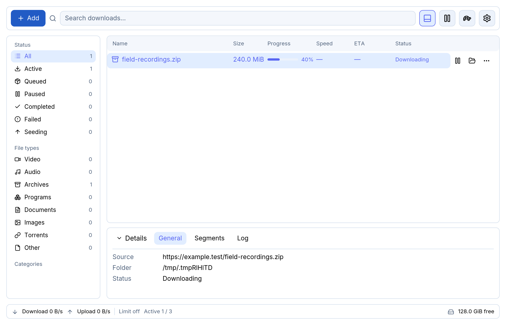

# Ruscello

Ruscello is a Rust download manager for Windows, Linux, and macOS. Its persistent queue handles
HTTP, HTTPS, FTP, FTPS, file hosters, BitTorrent, and media streams.

Get the Windows installer, Linux AppImage or Debian package, or macOS disk image from
[GitHub Releases](https://github.com/EmanueleFusco/ruscello/releases).

[Quickstart](docs/QUICKSTART.md) · [FAQ](docs/FAQ.md) · [Roadmap](docs/PLAN.md) · [Security](SECURITY.md)



## Key Features

- **HTTP and HTTPS** downloads use dynamic segmentation, bandwidth limits, and crash-safe checkpoints.
  The queue supports pause, resume, retry, checksum verification, and verified mirrors.
- **FTP and FTPS** support byte-offset resume via `REST` on servers that offer it. `ftps://` uses
  explicit TLS by default and implicit TLS when port 990 is specified.
- **BitTorrent** accepts magnets and `.torrent` files, with file selection, seeding limits, and piece rechecks.
- **Hoster plugins** cover `fuckingfast.co`, XFileSharing/DataNodes, and other services. Ruscello can renew an
  expired link and resume when the new response matches the saved file validators. Custom TOML recipes load
  without restarting the app. Pixeldrain and Gofile API tokens use the operating system credential store.
- **LinkGrabber** analyzes pages and explains why it ranked each result. Search or filter the list, select
  files, and queue them as packages. Import JDownloader `.dlc`, text lists, Metalink, and M3U playlists.
- **Media** includes native HLS and DASH transfers, quality selection, and playlist packages. Optional
  `yt-dlp` expands site support and `ffmpeg` merges separate audio and video tracks.
- **Remote control** includes a mobile-friendly LAN Web UI in **Settings → Integrations** and a
  [browser extension](extensions/browser/README.md) for Chrome/Chromium and Firefox.
- **Automation** includes time-of-day speed limits and queue scheduling, sleep inhibition and queue
  completion actions, watch folders, automatic checksum verification and archive extraction, and an
  optional post-download command. Configure these in **Settings → Automation**.
- **Desktop settings** include English and Italian with live switching, categories and rules, and hardware or
  software rendering. **Settings → About** shows the version, release notes, and available in-app updates.

When a site requires verification, select **Open verification** on the waiting download. Ruscello resumes
waiting downloads for that site when you finish in the browser window. Use **Analyze in browser** in Add to
include resources loaded by page scripts. **Settings → Integrations** offers site-scoped browser cookie import.

## Development

```bash
cargo build -p ruscello-webview      # Build the sibling helper for the GUI and CLI
cargo run -p ruscello-gui            # GUI application
cargo run -p ruscello-cli -- --help  # Headless CLI
./scripts/check.sh                   # (or scripts/check.ps1 on Windows) run all CI checks locally
```

The helper uses WebKitGTK 4.1 on Linux, WebView2 on Windows, and WKWebView on macOS. Install the Linux
development libraries listed in [AGENTS.md](AGENTS.md) or ensure the WebView2 Runtime is installed on Windows.

Developer & agent documentation: [AGENTS.md](AGENTS.md), [Architecture](docs/ARCHITECTURE.md),
[UI Specs](docs/UI.md), [Testing Strategy](docs/TESTING.md), [ADRs](docs/adr/).

### Download or inspect a link

```bash
cargo run -p ruscello-cli -- get <url> -o downloads -x 16
cargo run -p ruscello-cli -- get <url> --browser
cargo run -p ruscello-cli -- inspect <page-url> --browser
cargo run -p ruscello-cli -- get <stream-url> --format best
cargo run -p ruscello-cli -- import links.dlc
cargo run -p ruscello-cli -- queue <url>
cargo run -p ruscello-cli -- status
cargo run -p ruscello-cli -- --language it --help
```

Progress appears on standard error in a terminal. Use `--progress` to display it when redirected or
`--quiet` to suppress it. Standard output contains the path to the completed file.
Press Ctrl+C to interrupt a download. Run the same command to resume when the server supports validated byte ranges.
Use `--checksum sha256:<hex>` to verify the completed file, and repeat `--mirror <url>` to add verified sources.
The `queue` and `status` commands connect to the running desktop app.

The `inspect` and `import` commands print URLs to standard output. In the desktop app, use **Add** to review
and queue discovered files or imported packages. DLC import requests a key from JDownloader and decrypts
the payload locally. The optional dcrypt.it fallback sends the encrypted container and can be enabled in
**Settings → Integrations** or with `import links.dlc --dlc-fallback`. The Gofile plugin uses the official
Premium API for share listings.

See the [UI guide](docs/UI.md#unified-add-download-dialog) for the Add workflow and
[Resolver Pipeline](docs/ARCHITECTURE.md#resolver-pipeline) for the TOML recipe schema.

## License

[GPL-3.0-or-later](LICENSE)
