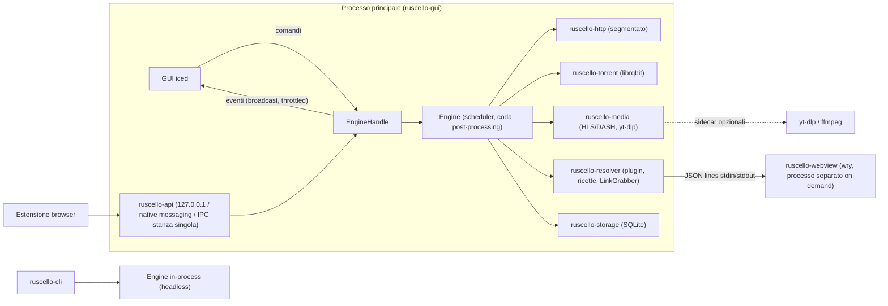
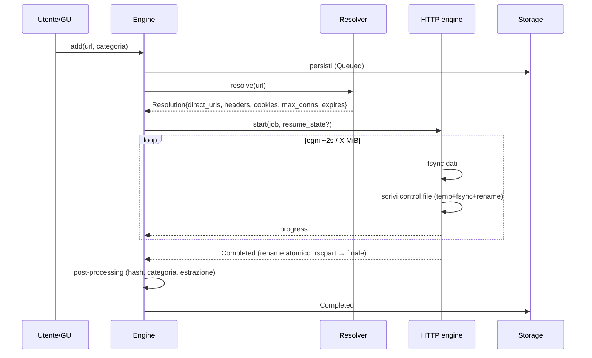

# Architettura di Ruscello

## Vista d'insieme



- **Engine in-process** come libreria: la GUI e la CLI creano un `Engine` sullo stesso runtime tokio
  (la GUI lo esegue su un runtime multi-thread dedicato; iced ha il suo loop sul main thread).
- **Webview in processo separato**: wry/tao vogliono il proprio event loop sul main thread, in conflitto
  con winit di iced; inoltre WebView2/WebKitGTK sono pesanti → avviato solo quando serve.

## Flusso di un download HTTP



Se il link diretto scade (403/410, redirect a pagina HTML) l'engine chiede un nuovo `Resolution` al
resolver e riprende dagli stessi byte (validando dimensione/ETag).

## Motore segmentato (ruscello-http)

- `SegmentAllocator` puro e deterministico (testato con proptest): ranges `[start, end)` assegnati a
  "worker"; work stealing del residuo più grande; numero connessioni adattivo (slow start fino al limite
  per-host o al limite dettato dal plugin hoster; riduzione su 429/503/reset).
- Worker = task tokio con una richiesta `Range` ciascuno; dati inviati al **writer task** tramite canale
  limitato (backpressure) in blocchi grandi.
- Writer: scritture posizionali sul file `.rscpart`; ogni checkpoint: `sync_data()` → aggiornamento ranges
  completati → scrittura atomica del control file.
- Rate limiter token bucket condiviso (globale + per-download) applicato ai worker.
- Connessioni: un `reqwest::Client` condiviso (pool, HTTP/2 dove disponibile, keep-alive); per H2 più
  range viaggiano sulla stessa connessione multiplexata — misurare se conviene forzare HTTP/1.1 per i
  segmenti (molti server limitano per-connessione): rendere configurabile, default deciso da benchmark.

## Resolver

```
input URL/testo
   │
   ├─ CrawlerPlugin (pagine indice, liste, container) ──► più URL ──┐
   │                                                              ▼
   └──────────────────────────────────────────────► HostPlugin / Ricetta TOML / Direct
                                                     │            │
                                         HTTP puro ◄─┘            └─► Browser helper (DOM, verifica utente,
                                                                       intercettazione download)
                                                     ▼
                                              Resolution → Engine
```

- `HostPlugin` (trait Rust) per hoster complessi; **ricette TOML** per siti semplici (anche aggiunte
  dall'utente in `<config>/recipes/`). Esempio indicativo (sintassi libera da definire in M5):

```toml
[recipe]
name = "xfilesharing-generic"
match = ["^https?://(www\\.)?example-host\\.tld/[a-z0-9]{12}"]
max_connections = 1

[[step]]
submit_form = { selector = "form[method=post]", button = "#method_free" }
[[step]]
wait = { from_page = "#countdown span", default_seconds = 10 }
[[step]]
submit_form = { selector = "form[name=F1]", button = "#downloadbtn" }
[[step]]
expect_download = true      # la risposta è il file → link diretto
```

- **LinkGrabber**: estrazione candidati + punteggio spiegabile (vedi PLAN M5.5); i probe di dimensione sono
  in parallelo con limite basso (es. 4) e timeout breve.

## Persistenza

- `<data_dir>/ruscello.db` (SQLite WAL): download, package, categorie, regole, impostazioni, cronologia.
- Accanto al file parziale: `nome.ext.rscpart` + `nome.ext.rscpart.ctl` (ranges completati, validatori,
  URL, versione formato, CRC). Il DB è la vista "logica", il control file la verità sui byte scritti:
  all'avvio si riconciliano.
- Torrent: stato/fastresume gestito da librqbit in `<data_dir>/torrent/`.
- Percorsi via crate `directories` (`%APPDATA%\Ruscello`, `~/.local/share/ruscello`, ecc.).

## Crate esterni consigliati (verificare versioni aggiornate)

| Ambito | Crate |
|--------|-------|
| GUI | `iced` (features: `tokio`, `advanced`, `image`, `svg`), `iced_test`, `tray-icon`, `notify-rust`, `rfd` (dialog file) |
| Async | `tokio`, `tokio-util`, `futures` |
| HTTP | `reqwest` (rustls, http2, stream, cookies, gzip/brotli solo per pagine), `hyper`, `url`, `cookie_store` |
| FTP | `suppaftp` |
| Torrent | `librqbit` |
| HTML/parsing | `scraper`, `regex`, `serde_json`, `quick-xml` (MPD), `m3u8-rs` |
| Storage | `rusqlite` (bundled), `rusqlite_migration`, `postcard`/`bincode` + `crc32fast` (control file) |
| Config/serde | `serde`, `toml` |
| Webview | `wry`, `tao` (solo in `apps/webview`) |
| Sistema | `directories`, `keyring`, `single-instance` o pipe/unix socket propri, `sysinfo` (spazio disco), `zbus` (Linux), `windows` (Win32) |
| File | `infer` (magic bytes), `zip`, `sevenz-rust2`, `tar`, `flate2`, `sha2`, `md-5`, `sha1`, `crc32fast` |
| Logging | `tracing`, `tracing-subscriber`, `tracing-appender` |
| i18n | `fluent`, `fluent-langneg`, `sys-locale` |
| Test | `proptest`, `insta`, `tempfile`, `axum` (testkit), `criterion`, `cargo-nextest`, `cargo-fuzz` |
| API | `axum` |

## Progetti di riferimento da studiare

| Progetto | Cosa guardare |
|----------|---------------|
| [qBittorrent](https://github.com/qbittorrent/qBittorrent) | UX torrent, impostazioni, sidebar filtri stato/categorie/tag |
| [JDownloader 2 (svn/AppWork)](https://svn.jdownloader.org/) / [mirror GitHub](https://github.com/mirror/jdownloader) | Plugin host/decrypter, LinkGrabber, Package, XFileSharingProBasic, gestione captcha manuale |
| [aria2](https://github.com/aria2/aria2) | Segmentazione (`--split`, `--min-split-size`), control file `.aria2`, mirror, metalink |
| [rqbit / librqbit](https://github.com/ikatson/rqbit) | API sessione torrent in Rust |
| [yt-dlp](https://github.com/yt-dlp/yt-dlp) | Output JSON (`-J`), progress template, gestione cookie |
| [gosh-dl](https://github.com/goshitsarch-eng/gosh-dl) | Motore di download Rust embeddabile (resume con ETag, code prioritarie) |
| [Free Download Manager](https://www.freedownloadmanager.org/), IDM | UX della lista e dialog di aggiunta (solo come riferimento visivo) |
| [Motrix](https://github.com/agalwood/Motrix), [AB Download Manager](https://github.com/amir1376/ab-download-manager) | UI minimale moderna per download manager, categorie |
| [iced examples](https://github.com/iced-rs/iced/tree/master/examples), [COSMIC apps](https://github.com/pop-os) | Pattern iced per app grandi |
