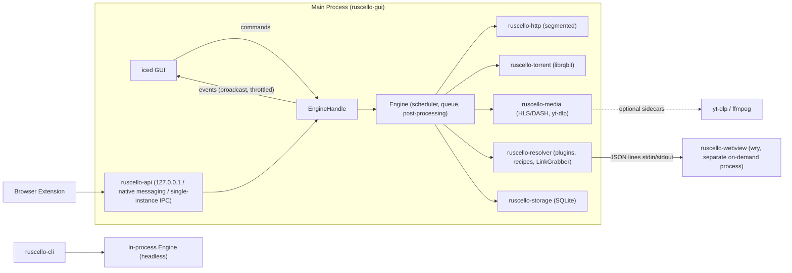
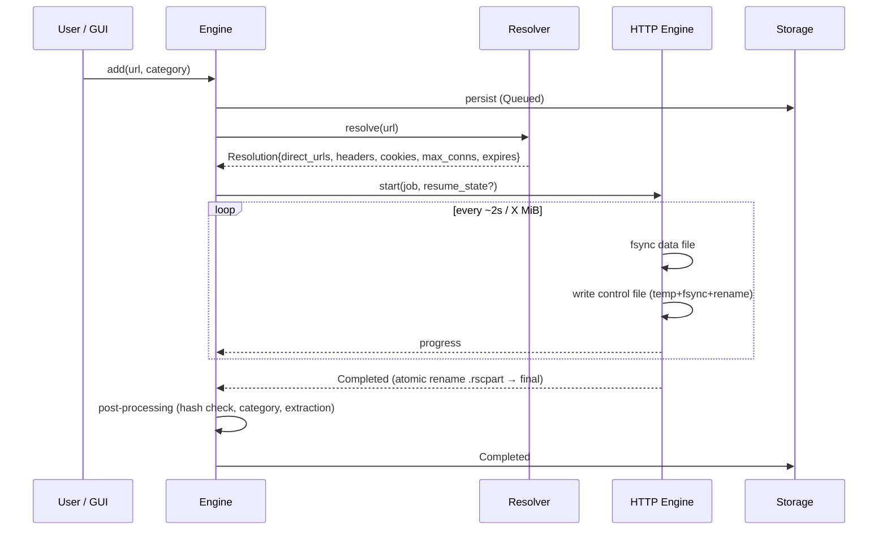

# Ruscello Architecture

## Overview



- **In-process Engine library**: both the GUI and the CLI instantiate `Engine` on a multi-threaded `tokio`
  runtime (`iced` runs its UI loop on the main thread).
- **Separate Webview process**: `wry`/`tao` require owning the main-thread event loop, which conflicts with
  `iced`'s `winit` loop; additionally, WebView2/WebKitGTK have a noticeable memory footprint and should only run
  when needed.

## HTTP Download Flow



If a direct link expires mid-download (`403`/`410` or redirect back to an HTML page), the engine requests a fresh
`Resolution` from the resolver and resumes from the exact persisted byte ranges (verifying size/`ETag`).

## Segmented HTTP Engine (`ruscello-http`)

- Pure, deterministic `SegmentAllocator` (verified via `proptest`): assigns `[start, end)` byte ranges to workers;
  performs dynamic work stealing by splitting the largest remaining range; adapts connection count via slow start
  up to the per-host or hoster-plugin limit, scaling back on `429`/`503`/resets.
- Each worker is a `tokio` task issuing a single HTTP `Range` request and streaming chunks over a bounded channel
  (backpressure) to the dedicated **writer task**.
- Writer: performs positional writes (`seek_write`/`write_at`) to `.rscpart`; on every checkpoint:
  `sync_data()` → update completed ranges → atomically write `.rscpart.ctl`.
- Shared token-bucket rate limiter (global + per-download) applied across workers.
- Mirror candidates must have the primary file's length and support validated ranges. The writer verifies the
  supplied file checksum before publishing data assembled from multiple sources.
- Connection management: shared `reqwest::Client` (connection pool, keep-alive); benchmark whether forcing HTTP/1.1
  for parallel range connections outperforms multiplexed HTTP/2 on throttled servers, and make it configurable.

## Resolver Pipeline

```
input URL / free text
   │
   ├─ CrawlerPlugin (index pages, lists, containers) ──► multiple URLs ──┐
   │                                                                     ▼
   └─────────────────────────────────────────────────────► HostPlugin / TOML Recipe / Direct
                                                            │            │
                                                Plain HTTP ◄┘            └─► Browser Helper (DOM actions,
                                                                             user check, download intercept)
                                                            ▼
                                                     Resolution → Engine
```

- `HostPlugin` (Rust trait) for complex hosters and `CrawlerPlugin` for collections. TOML recipes in
  `<config>/recipes/` are loaded in filename order on the next resolution or inspection. The CLI accepts
  `RUSCELLO_RECIPES_DIR` as a directory override.

```toml
[recipe]
name = "xfilesharing-generic"
match = ['^https?://(www\.)?example-host\.tld/[a-z0-9]{12}']
max_connections = 1
max_parallel = 1

[[step]]
get = ""

[[step]]
submit_form = { selector = "form[method=post]", button = "#method_free" }
[[step]]
wait = { from_page = "#countdown span", default_seconds = 10 }
[[step]]
submit_form = { selector = "form[name=F1]", button = "#downloadbtn" }
[[step]]
expect_download = true
```

- `extract = { css = "a#file", attribute = "href" }` or `extract = { regex = '...' }` selects a URL.
  `follow = true` loads that URL for another step. `browser = true` permits `click` and `wait_for`
  selectors in the browser helper. The helper uses fixed DOM actions and checks for a verification page
  before each action. Each `wait` preserves the configured or page-provided countdown.
- **LinkGrabber** probes up to 16 same-origin candidates per page, four at a time. The resolver reloads
  `<config>/recipes/blocked-hosts.txt` for each analyzed page, accepting domains, hosts entries, and
  plain EasyList domain rules such as `||example.test^`.
- **`.dlc` (Download Link Container) Decryption (`ruscello-resolver`)**:
  1. Trim whitespace from the `.dlc` file; split into `encrypted_body_b64 = raw[..raw.len()-88]` and
     `dlc_key = raw[raw.len()-88..]` (88 ASCII chars).
  2. Exchange `dlc_key` via `GET https://service.jdownloader.org/dlcrypt/service.php?srcType=dlc&destType=pylo&data=<dlc_key>`
     and extract `<rc>...</rc>`. The optional fallback sends the encrypted container to
     `https://dcrypt.it/decrypt/paste` when enabled in desktop settings or with `import --dlc-fallback` in the CLI.
  3. Base64-decode `<rc>` and decrypt with **AES-128-CBC (no padding)** using static key `b"cb99b5cbc24db398"` and
     IV `b"9bc24cb995cb8db3"` (crates `aes` + `cbc` + `base64`) → yields the 16-byte ASCII `real_key`.
  4. Base64-decode `encrypted_body_b64`, decrypt with **AES-128-CBC (no padding)** using `key = real_key` and
     `iv = real_key`, strip trailing null/whitespace padding, and Base64-decode the resulting string into XML (`<dlc>`).
  5. Parse `<package name="...">` and `<file><url>...</url><filename>...</filename><size>...</size></file>` (each
     attribute/tag text is individually Base64-encoded) into a Ruscello `Package`.

## Local API & LAN Remote Web UI (`ruscello-api`)

- Built on `axum`, serving both:
  1. **Local IPC / Browser Extension API** on `127.0.0.1` (token-authenticated);
  2. **Optional LAN Remote Web UI** on `0.0.0.0:<port>` (qBittorrent Web UI style, disabled by default, enabled in Settings):
     - Serves a self-contained, mobile-responsive single-page web interface bundled into the binary (HTML/CSS/JS via
       `include_str!`) localized in `en` and `it`, plus REST and Server-Sent Events / WebSocket endpoints for live progress.
     - Supports **optional password protection** (user can choose open access on a trusted LAN or password authentication
       verified via Argon2/SHA-256 hash and HttpOnly session cookie).
     - Desktop Settings displays the local LAN address (`http://<lan-ip>:<port>`) and generates a scannable **QR Code** (`qrcode` crate).

## Persistence

- `<data_dir>/ruscello.db` (SQLite WAL): downloads, packages, categories, rules, settings, history.
- Alongside each partial download: `filename.ext.rscpart` + `filename.ext.rscpart.ctl` (completed byte ranges,
  remote validators, hashed source identity, format version, CRC32). SQLite holds the logical queue view while the control
  file is the source of truth for persisted bytes; both are reconciled on startup.
- For plugin-resolved links, a strong ETag and matching size permit resume across token changes on the same
  download origin. The checkpoint is keyed by the original share URL. Resolved URLs, request headers, and
  account tokens stay out of the queue record. Explicit container filenames, mirrors, and checksums survive
  restart. Mirrors can contribute bytes only when the result has an expected checksum.
- The storage actor keeps a standalone SQLite backup next to the database. If both copies are corrupt, the engine
  can reconstruct paused entries from managed checkpoints in the configured recovery folders. Those checkpoints
  include the job ID and destination. URLs containing query strings or user information are excluded from checkpoints.
  Older checkpoints still reconcile against a known queue entry by hashed source identity.
- The scheduler starts eligible jobs by force-start request, priority, then manual queue order. Force start
  respects the global download and per-host connection caps. Changes to limits are saved in SQLite.
- Managed downloads stage completed data in their working directory before publishing to the destination.
  Publication uses a saved filename and a no-clobber operation. The staging copy is kept until the
  completed state is committed, so a restart can finish publication without downloading the file again.
- Category assignment evaluates rules in order when a job is added. Rules can match the host, a filename
  from the source URL or add request, a regular expression, or the source type. An explicit category or
  destination takes precedence. A category can share a bandwidth cap and concurrent-download limit.
- File type is recorded at completion using a bounded magic-byte read, the probed MIME type, and the
  filename extension. The inferred type is independent of user categories.
- An optional temporary directory holds working files for new jobs. Before opening the writer, the
  engine checks space for known remaining bytes plus a configurable reserve. It checks the reserve
  periodically during the transfer and pauses with a warning if space runs low. Cross-volume publication
  checks space for a copy before publishing it atomically.
- BitTorrent state and fastresume data are managed by `librqbit` under `<data_dir>/torrent/`.
- `ruscello-browser` starts the sibling `ruscello-webview` binary on demand and exchanges bounded JSON-lines
  frames over its private pipes. It shuts the process down after 60 seconds of idle time. The next request
  starts a fresh helper if the process previously stopped. Native persistent profiles use
  `<data_dir>/webview_profile/` on Windows and Linux. On macOS, the directory stores the profile UUID
  for WKWebView's OS-managed store (macOS 14 and later); older macOS uses the persistent default WKWebView store.
  The resolver holds the exported cookies and User-Agent in memory, keyed by scheme, host, and port. The
  queue does not persist them. Firefox and readable Chromium cookies can be imported for an explicit site.
- Standard OS directories resolved via the `directories` crate (`%APPDATA%\Ruscello`, `~/.local/share/ruscello`, etc.).

## Recommended External Crates (Verify Latest Releases on crates.io)

| Area | Crates |
|------|--------|
| GUI | `iced` (features: `wgpu` [default], `tiny-skia` [selectable in Settings for G-SYNC/OLED setups], `tokio`, `advanced`, `image`, `svg` — see ADR-0001), `iced_test`, `tray-icon`, `notify-rust`, `rfd` (file dialogs) |
| Async | `tokio`, `tokio-util`, `futures` |
| HTTP | `reqwest` (`rustls`, `http2`, `stream`, `cookies`, `gzip`/`brotli` for HTML pages only), `hyper`, `url`, `cookie_store` |
| FTP | `suppaftp` |
| BitTorrent | `librqbit` |
| HTML / Parsing | `scraper`, `regex`, `serde_json`, `quick-xml` (MPD), `m3u8-rs` |
| Storage | `rusqlite` (`bundled`), `rusqlite_migration`, `postcard`/`bincode` + `crc32fast` (control file) |
| Config / Serde | `serde`, `toml` |
| Webview | `wry`, `tao` (isolated to `apps/webview`) |
| OS Integration & Updater | `directories`, `keyring`, `single-instance` (or custom named pipe / Unix socket), `sysinfo` (disk space), `zbus` (Linux), `windows` (Win32), `semver`, `self-replace` (in-app GitHub Release self-updater) |
| Files / Archives / Crypto | `infer` (magic bytes), `zip`, `sevenz-rust2`, `tar`, `flate2`, `bzip2-rs`, `lzma-rs`, `sha2`, `md-5`, `sha1`, `crc32fast`, `aes`, `cbc`, `base64` (`.dlc` container decryption & HLS AES-128) |
| Logging | `tracing`, `tracing-subscriber`, `tracing-appender` |
| Localization (i18n) | `fluent`, `fluent-langneg`, `sys-locale` (`en` + `it` bundles, runtime switchable) |
| Testing | `proptest`, `insta`, `tempfile`, `axum` (testkit), `criterion`, `cargo-nextest`, `cargo-fuzz` |
| Local API & LAN Web UI | `axum`, `local-ip-address`, `qrcode` (LAN Web UI QR code in Settings) |

## Reference Open-Source Projects to Study

| Project | What to Study |
|---------|---------------|
| [qBittorrent](https://github.com/qbittorrent/qBittorrent) | Torrent UX, settings structure, sidebar filters (status/categories/tags) |
| [JDownloader 2 (svn/AppWork)](https://svn.jdownloader.org/) / [GitHub mirror](https://github.com/mirror/jdownloader) | Host/decrypter plugin architecture, LinkGrabber, Packages, `XFileSharingProBasic`, user verification flow |
| [aria2](https://github.com/aria2/aria2) | Segmentation (`--split`, `--min-split-size`), `.aria2` control file layout, mirrors, metalink |
| [rqbit / librqbit](https://github.com/ikatson/rqbit) | Rust BitTorrent session API |
| [yt-dlp](https://github.com/yt-dlp/yt-dlp) | JSON dump (`-J`), progress template, cookie handling |
| [gosh-dl](https://github.com/goshitsarch-eng/gosh-dl) | Embeddable Rust download engine (ETag resume, priority queues) |
| [Free Download Manager](https://www.freedownloadmanager.org/), IDM | List view and Add Download dialog UX (visual reference only) |
| [Motrix](https://github.com/agalwood/Motrix), [AB Download Manager](https://github.com/amir1376/ab-download-manager) | Clean, modern download manager UI and categorization |
| [iced examples](https://github.com/iced-rs/iced/tree/master/examples), [COSMIC apps](https://github.com/pop-os) | Idiomatic patterns for large `iced` desktop applications |
