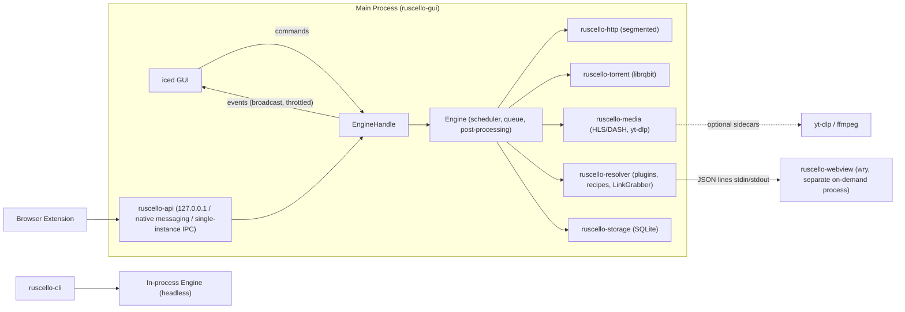
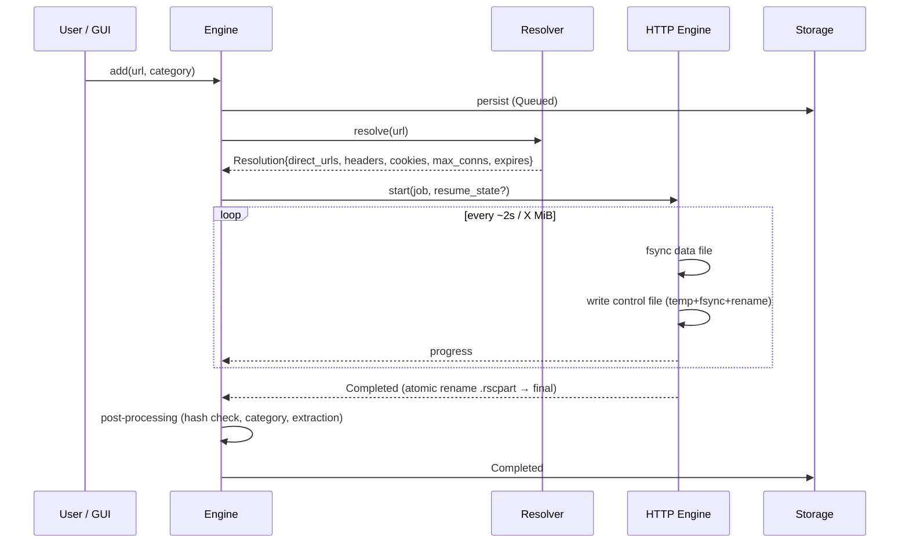

# Ruscello Architecture

## Overview



- **In-process Engine library**: both the GUI and the CLI instantiate `Engine` on a multi-threaded `tokio`
  runtime (`iced` runs its UI loop on the main thread).
- **Separate Webview process**: `wry`/`tao` require owning the main-thread event loop, which conflicts with
  `iced`'s `winit` loop; additionally, WebView2/WebKitGTK have a noticeable memory footprint and should only run
  when needed.

## HTTP Download Flow



If a direct link expires mid-download (`403`/`410` or redirect back to an HTML page), the engine requests a fresh
`Resolution` from the resolver and resumes from the exact persisted byte ranges (verifying size/`ETag`).

## Segmented HTTP Engine (`ruscello-http`)

- Pure, deterministic `SegmentAllocator` (verified via `proptest`): assigns `[start, end)` byte ranges to workers;
  performs dynamic work stealing by splitting the largest remaining range; adapts connection count via slow start
  up to the per-host or hoster-plugin limit, scaling back on `429`/`503`/resets.
- Each worker is a `tokio` task issuing a single HTTP `Range` request and streaming chunks over a bounded channel
  (backpressure) to the dedicated **writer task**.
- Writer: performs positional writes (`seek_write`/`write_at`) to `.rscpart`; on every checkpoint:
  `sync_data()` → update completed ranges → atomically write `.rscpart.ctl`.
- Shared token-bucket rate limiter (global + per-download) applied across workers.
- Mirror candidates must have the primary file's length and support validated ranges. The writer verifies the
  supplied file checksum before publishing data assembled from multiple sources.
- Connection management: shared `reqwest::Client` (connection pool, keep-alive); benchmark whether forcing HTTP/1.1
  for parallel range connections outperforms multiplexed HTTP/2 on throttled servers, and make it configurable.

## Resolver Pipeline

```
input URL / free text
   │
   ├─ CrawlerPlugin (index pages, lists, containers) ──► multiple URLs ──┐
   │                                                                     ▼
   └─────────────────────────────────────────────────────► HostPlugin / TOML Recipe / Direct
                                                            │            │
                                                Plain HTTP ◄┘            └─► Browser Helper (DOM actions,
                                                                             user check, download intercept)
                                                            ▼
                                                     Resolution → Engine
```

- `HostPlugin` (Rust trait) for complex hosters; declarative **TOML recipes** for simpler sites (including
  user-defined recipes in `<config>/recipes/`). Illustrative syntax (final schema defined in M5):

```toml
[recipe]
name = "xfilesharing-generic"
match = ["^https?://(www\\.)?example-host\\.tld/[a-z0-9]{12}"]
max_connections = 1

[[step]]
submit_form = { selector = "form[method=post]", button = "#method_free" }
[[step]]
wait = { from_page = "#countdown span", default_seconds = 10 }
[[step]]
submit_form = { selector = "form[name=F1]", button = "#downloadbtn" }
[[step]]
expect_download = true      # response is the file → direct link
```

- **LinkGrabber**: candidate extraction + explainable scoring (see `PLAN.md` M5.5); parallel size probes are
  bounded (e.g., max 4 concurrent probes with short timeouts).

## Persistence

- `<data_dir>/ruscello.db` (SQLite WAL): downloads, packages, categories, rules, settings, history.
- Alongside each partial download: `filename.ext.rscpart` + `filename.ext.rscpart.ctl` (completed byte ranges,
  remote validators, hashed source identity, format version, CRC32). SQLite holds the logical queue view while the control
  file is the source of truth for persisted bytes; both are reconciled on startup.
- BitTorrent state and fastresume data are managed by `librqbit` under `<data_dir>/torrent/`.
- Standard OS directories resolved via the `directories` crate (`%APPDATA%\Ruscello`, `~/.local/share/ruscello`, etc.).

## Recommended External Crates (Verify Latest Releases on crates.io)

| Area | Crates |
|------|--------|
| GUI | `iced` (features: `wgpu` [default], `tiny-skia` [selectable in Settings for G-SYNC/OLED setups], `tokio`, `advanced`, `image`, `svg` — see ADR-0001), `iced_test`, `tray-icon`, `notify-rust`, `rfd` (file dialogs) |
| Async | `tokio`, `tokio-util`, `futures` |
| HTTP | `reqwest` (`rustls`, `http2`, `stream`, `cookies`, `gzip`/`brotli` for HTML pages only), `hyper`, `url`, `cookie_store` |
| FTP | `suppaftp` |
| BitTorrent | `librqbit` |
| HTML / Parsing | `scraper`, `regex`, `serde_json`, `quick-xml` (MPD), `m3u8-rs` |
| Storage | `rusqlite` (`bundled`), `rusqlite_migration`, `postcard`/`bincode` + `crc32fast` (control file) |
| Config / Serde | `serde`, `toml` |
| Webview | `wry`, `tao` (isolated to `apps/webview`) |
| OS Integration | `directories`, `keyring`, `single-instance` (or custom named pipe / Unix socket), `sysinfo` (disk space), `zbus` (Linux), `windows` (Win32) |
| Files / Archives / Hashes | `infer` (magic bytes), `zip`, `sevenz-rust2`, `tar`, `flate2`, `sha2`, `md-5`, `sha1`, `crc32fast` |
| Logging | `tracing`, `tracing-subscriber`, `tracing-appender` |
| Localization (i18n) | `fluent`, `fluent-langneg`, `sys-locale` (`en` + `it` bundles, runtime switchable) |
| Testing | `proptest`, `insta`, `tempfile`, `axum` (testkit), `criterion`, `cargo-nextest`, `cargo-fuzz` |
| Local API | `axum` |

## Reference Open-Source Projects to Study

| Project | What to Study |
|---------|---------------|
| [qBittorrent](https://github.com/qbittorrent/qBittorrent) | Torrent UX, settings structure, sidebar filters (status/categories/tags) |
| [JDownloader 2 (svn/AppWork)](https://svn.jdownloader.org/) / [GitHub mirror](https://github.com/mirror/jdownloader) | Host/decrypter plugin architecture, LinkGrabber, Packages, `XFileSharingProBasic`, user verification flow |
| [aria2](https://github.com/aria2/aria2) | Segmentation (`--split`, `--min-split-size`), `.aria2` control file layout, mirrors, metalink |
| [rqbit / librqbit](https://github.com/ikatson/rqbit) | Rust BitTorrent session API |
| [yt-dlp](https://github.com/yt-dlp/yt-dlp) | JSON dump (`-J`), progress template, cookie handling |
| [gosh-dl](https://github.com/goshitsarch-eng/gosh-dl) | Embeddable Rust download engine (ETag resume, priority queues) |
| [Free Download Manager](https://www.freedownloadmanager.org/), IDM | List view and Add Download dialog UX (visual reference only) |
| [Motrix](https://github.com/agalwood/Motrix), [AB Download Manager](https://github.com/amir1376/ab-download-manager) | Clean, modern download manager UI and categorization |
| [iced examples](https://github.com/iced-rs/iced/tree/master/examples), [COSMIC apps](https://github.com/pop-os) | Idiomatic patterns for large `iced` desktop applications |
