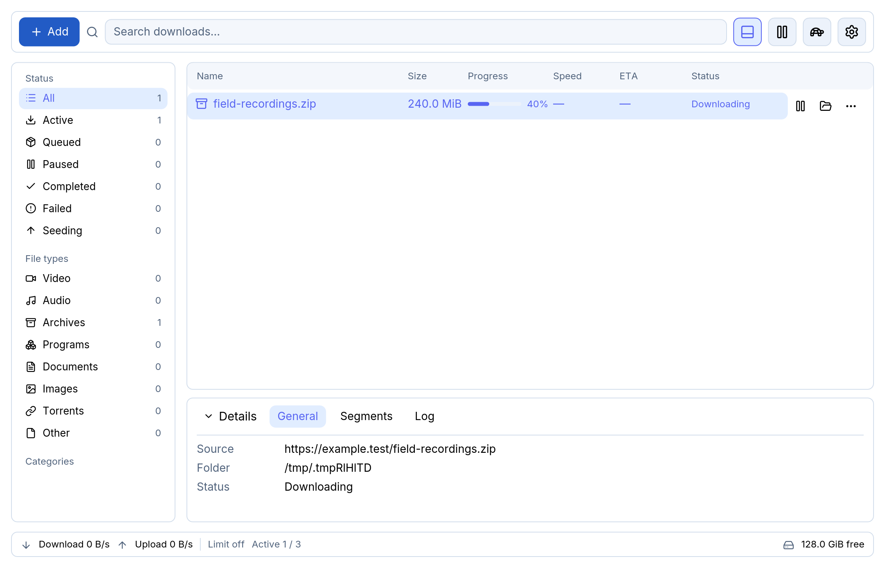
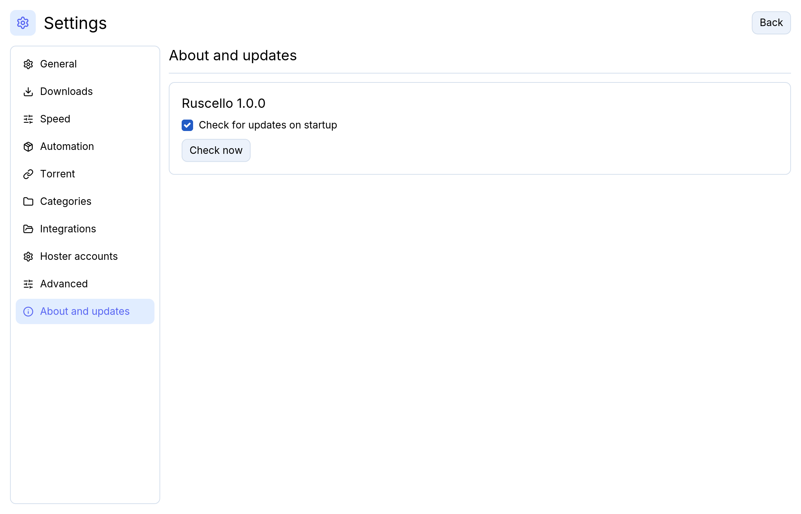

# Ruscello quickstart

## Install

Get your platform package from [GitHub Releases](https://github.com/EmanueleFusco/ruscello/releases).
Check that the OS and architecture in the filename match your system.

| Platform | Package | Installation |
|---|---|---|
| Windows x64 | `.exe` | Run the per-user installer. The browser helper needs the Microsoft Edge WebView2 Runtime. |
| Ubuntu 24.04 or compatible Linux x64 | `.deb` | Run `sudo apt install ./ruscello-v1.0.0-linux-x86_64.deb` from the download directory. |
| Ubuntu 24.04 or compatible Linux x64 | `.AppImage` | Install the dependencies below, make the file executable, and run it. Keep it in a writable folder if you want one-click updates. |
| macOS | `.dmg` | Open the image and drag Ruscello to Applications. Choose `aarch64` for Apple Silicon or `x86_64` for Intel. |

The AppImage uses the system's GTK, WebKitGTK, and desktop integration libraries. On Ubuntu 24.04:

```sh
sudo apt install libfuse2t64 libgtk-3-0t64 libwebkit2gtk-4.1-0 libxkbcommon0 libxdo3 libayatana-appindicator3-1
chmod +x ruscello-v1.0.0-linux-x86_64.AppImage
./ruscello-v1.0.0-linux-x86_64.AppImage
```

The release includes `SHA256SUMS`. Compare the entry for your file with `Get-FileHash <file>` on Windows,
`sha256sum <file>` on Linux, or `shasum -a 256 <file>` on macOS. Current Windows and macOS packages can
display system prompts for unsigned or unnotarized applications.

## Add and manage a download

1. Select **Add** and paste a link or drop a `.torrent`, `.dlc`, or text file. You can paste several URLs at once.
2. Review the discovered files, select the ones to queue, and optionally choose a category and destination.
3. Select **Add** or **Download selected**. Use the row actions to pause, resume, or open the destination.
   Click **Details** to inspect the selected item.
4. If a row shows **Verification required**, choose **Open verification** and complete the check in the browser window.



Use **Settings → General → Language** to switch between English and Italian. Set the destination and transfer
limits under **Downloads**.

## Update

Open **Settings → About** and select **Check now**, or open the toolbar update pill when it appears.
Review the release notes and choose **Update & restart**. Ruscello downloads and verifies the asset, saves the
queue and active transfer checkpoints, installs the update, and restarts. Downloads that were running can
resume when the application comes back. The startup check can be disabled from the same page.



For Debian packages and source builds, use your package manager or install the new build yourself.
See the [FAQ](FAQ.md) for resume, verification, sidecars, and local network control.
